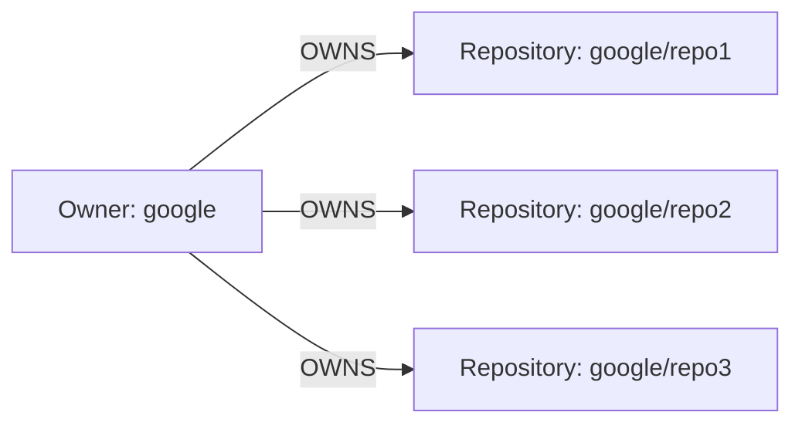

# SDC435L – GitHub Data Analysis Group Project

## Project Overview

This ECPI University SDC435L group project develops a modular
Python command-line application to explore GitHub Archive
repository data using five database technologies over five weeks:

- Redis (key-value)
- MongoDB (document)
- Cassandra (wide-column)
- Neo4j (graph)
- SQLite (relational)

The application provides a centralized entry point through
`main.py`, with separate modules for database connectivity,
dataset imports, CRUD operations, and repository data analysis.

Weeks 1, 2, and 3 have been implemented, tested, and submitted.

Week 4 introduces Neo4j graph database integration. Database
connectivity, graph schema initialization, dataset importing,
and repository owner relationship analysis have been implemented
and tested locally.

Additional Neo4j analysis features, CRUD operations, and central
menu integration remain in progress.

SQLite integration is scheduled for Week 5.

## Development Status

| Week | Database | Status |
| --- | --- | --- |
| 1 | Redis | Complete and submitted |
| 2 | MongoDB | Complete and submitted |
| 3 | Cassandra | Complete and submitted |
| 4 | Neo4j | In progress - core infrastructure and Feature 2 tested |
| 5 | SQLite | Planned |

---

## Week 1: Redis Integration

Redis stores repository records as JSON strings using keys
formatted as `github:repo:owner/repository`.

### Redis Implemented Features

- Local Redis connection and connectivity verification.
- JSON Lines dataset import of up to 1,000 valid records.
- Interactive Create, Read, Update, and Delete operations.
- Duplicate repository prevention.
- Repository popularity analysis.
- Top 10 repository owners.
- Repository watch count statistics.
- Repository name length analysis module.
- Integration with the central application menu.

### Data Import

The `redis_db/import_repositories.py` module reads
`Sample_Repos.json` from the project root.

The importer validates repository names and watch counts,
skips invalid records, and uses conditional insertion
(`nx=True`) to prevent existing records from being overwritten.

Import results report:

- Valid records processed.
- Newly imported repositories.
- Existing repositories.
- Invalid records skipped.

### Redis Analysis Modules

| Module | Purpose |
| -------- | --------- |
| `repository_popularity.py` | Top 10 repositories by watch count |
| `owner_analysis.py` | Top 10 repository owners |
| `repository_statistics.py` | Watch count descriptive statistics |
| `repo_name_length_analysis.py` | Repository name length analysis |

The original Redis popularity analysis was also tested
against 277,771 records in the initial development environment.

The integrated application uses a reproducible
1,000-record sample.

---

## Week 2: MongoDB Integration

MongoDB stores repository records as BSON documents in the
`GitHubArchive` database and `Repositories` collection.

Default connection:

`mongodb://localhost:27017/`

### Connection and Import

- Reusable database connection and collection functions.
- Connectivity verification and error handling.
- Repository name and watch count validation.
- Integer conversion for watch counts.
- Non-destructive imports using `$setOnInsert` and upsert.
- Unique ascending index on `repo_name`.
- Descending index on `watch_count`.

### CRUD Operations

The `mongodb_db/mongo_crud.py` module provides interactive
repository management using:

- `insert_one()`
- `find_one()`
- `update_one()`
- `delete_one()`

The application validates repository identifiers and watch
counts, rejects duplicates, requests confirmation before
deletion, and handles missing repositories.

### MongoDB Analysis Modules

| Module | Purpose |
| -------- | --------- |
| `mongo_repository_analysis.py` | Top 10 repositories by watch count |
| `mongo_name_analysis.py` | Five longest and shortest repository names |
| `mongo_watch_distribution.py` | Watch count distribution and percentages |

The original MongoDB popularity analysis was tested with
400,000 records before being refactored to use the shared
database connection and existing collection data.

The integrated implementation was tested using 1,000 documents.

---

## Week 3: Cassandra Integration

Cassandra stores repository records using a wide-column
database model and Cassandra Query Language (CQL).

### Database Configuration

| Setting | Value |
| --------- | ------- |
| Host | 127.0.0.1 |
| Port | 9042 |
| Keyspace | github_archive |
| Table | repositories |
| Primary key | repo_name |
| Repository name type | TEXT |
| Watch count type | INT |
| Replication factor | 1 |
| Consistency level | ONE |

The replication and consistency settings are intended for
the local, single-node development environment rather than
a production deployment.

### Cassandra Implemented Features

- Reusable Cassandra connection and session management.
- Keyspace and table configuration.
- JSON Lines dataset import.
- Prepared CQL statements.
- Conditional insertion using `IF NOT EXISTS`.
- Interactive Create, Read, Update, and Delete operations.
- Repository name and watch count validation.
- Cassandra integer range validation.
- Three repository analysis features.
- Central application menu integration.
- Automated watch count distribution tests.

### Analysis Features

The `cassandra_db/cassandra_analysis.py` module provides:

1. Top 10 repositories ranked by watch count.
2. Longest and shortest repository names, including
   average repository name length.
3. Watch count distribution across defined ranges.

The watch count distribution implementation was corrected
to ensure each repository is assigned to the appropriate
watch count range.

### Development Environments

Cassandra development was performed using two environments:

| Component | Local macOS | ECPI VCASTLE |
| ----------- | ------------- | -------------- |
| Operating system | macOS | Ubuntu Linux |
| Python | 3.13 | 3.8.10 |
| Cassandra | 5.0.9 | 4.0.5 |
| Deployment | Docker | Local installation |
| Python driver | 3.29.3 | 3.29.3 |

Dependency compatibility should be verified when installing
the updated application in either environment.

---

## Week 4: Neo4j Integration

Week 4 introduces Neo4j, a graph database used to model and
analyze relationships between GitHub repository owners and
their repositories.

Unlike the previous database implementations, Neo4j represents
data using nodes, relationships, and properties. Cypher queries
allow the application to analyze connected data directly.

### Neo4j Database Configuration

| Configuration | Value |
| --- | --- |
| Database | Neo4j Community Edition |
| Server Version | 5.26.33 |
| Python Driver | neo4j 5.28.2 |
| Database Name | neo4j |
| Bolt URI | bolt://localhost:7687 |
| Browser URL | <http://localhost:7474> |
| Import Record Limit | 1,000 |
| Import Batch Size | 100 |

Database credentials are configured through environment
variables rather than hardcoded into the application.

### Graph Database Design

The graph consists of two node labels and one relationship type.

#### Owner Node

- Label: `Owner`
- Property: `name`
- Unique identifier: `name`

#### Repository Node

- Label: `Repository`
- Property: `repo_name`
- Property: `watch_count`
- Unique identifier: `repo_name`

#### Ownership Relationship

- Type: `OWNS`
- Direction: Owner to Repository
- Cardinality: One-to-many



The intended graph model assigns each repository to one owner, while
an owner may own multiple repositories. The diagram uses illustrative
repository names. Ownership cardinality is maintained by application
logic rather than the uniqueness constraints alone.

The following uniqueness constraints prevent duplicate
owner and repository identifiers:

- `owner_name_unique`
- `repository_name_unique`

### Connection and Schema Initialization

The `neo4j_connection.py` module provides a reusable database
driver configured through environment variables.

The connection module:

- Requires a database password through an environment variable.
- Verifies connectivity before returning the driver.
- Releases driver resources if connectivity verification fails.
- Supports configurable connection and database settings.

The `neo4j_schema.py` module initializes uniqueness constraints
using `CREATE CONSTRAINT IF NOT EXISTS`, allowing schema
initialization to be repeated safely.

### Neo4j Data Import

The `neo4j_import.py` module imports repository records from
`Sample_Repos.json` into Neo4j.

The import process:

- Uses `orjson` for optimized JSON decoding.
- Reuses the shared repository name and watch count validators.
- Extracts owner names from repository identifiers.
- Converts numeric watch count strings into integers.
- Rejects watch counts exceeding Neo4j's signed 64-bit
  integer limit.
- Processes up to 1,000 valid records.
- Writes records in batches of 100 using parameterized
  Cypher queries.
- Uses `MERGE` to prevent duplicate nodes and ownership
  relationships during repeated imports.
- Uses `ON CREATE SET` to preserve existing repository
  watch counts.
- Reports valid records, invalid records, newly created
  nodes, and newly created relationships.

### Neo4j Implemented Features

| Feature | Module | Status |
| --- | --- | --- |
| Database connection | neo4j_connection.py | Complete |
| Graph schema initialization | neo4j_schema.py | Complete |
| JSON dataset import | neo4j_import.py | Complete |
| Feature 2: Repository Owner Relationship Analysis | owner_analysis.py | Complete |
| CRUD operations | Pending integration | In Progress |
| Feature 1: Top repositories by watch count | Pending integration | In Progress |
| Feature 3: Related repository analysis | Pending integration | In Progress |
| Interactive menu integration | Pending integration | In Progress |

### Feature 2: Repository Owner Relationship Analysis

The `owner_analysis.py` module uses Cypher queries to analyze
ownership relationships between repository owners and their
repositories.

The analysis provides three categories of results:

#### Ownership Overview

- Total connected owners.
- Total connected repositories.
- Total ownership relationships.

#### Top 10 Repository Owners

- Owner ranking by repository count.
- Number of repositories per owner.
- Combined repository watch counts.
- Average watch count per repository.
- Deterministic ordering for owners with equal repository counts.

#### Ownership Distribution

- Number and percentage of single-repository owners.
- Number and percentage of multiple-repository owners.
- Average repositories per owner.
- Maximum repositories owned by a single owner.

The analysis separates database queries from output formatting
to improve maintainability and automated testability.

Results represent the imported dataset rather than the entire
GitHub platform. Owners without connected repositories are
excluded from the ownership analysis.

### Development Environment

The Neo4j connection, schema initialization, dataset import,
and repository owner analysis were developed and tested
locally using:

- macOS on Apple Silicon.
- Python 3.13.15.
- Docker Desktop.
- Neo4j Community Edition 5.26.33.
- Neo4j Python driver 5.28.2.
- Visual Studio Code.

Installation compatibility for the Neo4j Python driver was
checked using a Python 3.8.10 dependency installation
simulation.

Full VCASTLE runtime compatibility and team integration
testing remain pending.

## Project Structure

```text
SDC435L-GitHub-Data-Analysis/
├── main.py
├── input_validation.py
├── test_input_validation.py
├── redis_db/
│   ├── __init__.py
│   ├── import_repositories.py
│   ├── owner_analysis.py
│   ├── redis_crud.py
│   ├── redis_menu.py
│   ├── repo_name_length_analysis.py
│   ├── repository_popularity.py
│   └── repository_statistics.py
├── mongodb_db/
│   ├── __init__.py
│   ├── mongo_connection.py
│   ├── mongo_crud.py
│   ├── mongo_import.py
│   ├── mongo_menu.py
│   ├── mongo_name_analysis.py
│   ├── mongo_repository_analysis.py
│   └── mongo_watch_distribution.py
├── cassandra_db/
│   ├── __init__.py
│   ├── cassandra_analysis.py
│   ├── cassandra_connection.py
│   ├── cassandra_crud.py
│   ├── cassandra_import.py
│   ├── cassandra_menu.py
│   ├── test_cassandra_analysis.py
│   └── test_cassandra_crud.py
├── neo4j_db/
│   ├── __init__.py
│   ├── neo4j_connection.py
│   ├── neo4j_schema.py
│   ├── neo4j_import.py
│   ├── owner_analysis.py
│   ├── test_neo4j_import.py
│   └── test_owner_analysis.py
├── requirements.txt
├── README.md
├── .gitignore
└── Sample_Repos.json
```

The dataset is provided through the course and is not
tracked in Git.

Local environment files, virtual environments, and Python
cache directories are excluded through `.gitignore`.

---

## Requirements

- Python 3
- Git
- Redis server
- MongoDB Community Server
- Apache Cassandra
- Neo4j Community Edition (5.26 tested locally)
- Docker Desktop for local containerized deployments on macOS
  (not required when database servers are already installed in VCASTLE)
- GitHub Archive `Sample_Repos.json` dataset

### Python Dependencies

Dependencies are managed through `requirements.txt`.

```text
redis==6.1.1
pymongo==4.10.1
cassandra-driver==3.29.3
orjson>=3.10.7,<4
neo4j==5.28.2
```

---

## Setup and Installation

### 1. Clone the Repository

```bash
git clone https://github.com/Anonas2638/SDC435L-GitHub-Data-Analysis.git

cd SDC435L-GitHub-Data-Analysis
```

### 2. Create a Virtual Environment

```bash
python3 -m venv .venv
source .venv/bin/activate
```

For Windows PowerShell:

```powershell
.venv\Scripts\Activate.ps1
```

Install dependencies:

```bash
python -m pip install -r requirements.txt
```

### 3. Start Redis

On macOS using Homebrew:

```bash
brew install redis
brew services start redis
```

Verify the connection:

```bash
redis-cli ping
```

Expected output:

```text
PONG
```

### 4. Start MongoDB

On macOS using Homebrew:

```bash
brew tap mongodb/brew
brew install mongodb-community
brew services start mongodb-community
```

Verify the connection:

```bash
mongosh --eval 'db.adminCommand({ ping: 1 })'
```

MongoDB should return `ok: 1`.

### 5. Start Cassandra

For local development using Docker Desktop:

```bash
docker run -d \
  --name cassandra-week3 \
  -p 127.0.0.1:9042:9042 \
  -e MAX_HEAP_SIZE=1G \
  -e HEAP_NEWSIZE=200M \
  -v cassandra-week3-data:/var/lib/cassandra \
  cassandra:5.0
```

If the container already exists, start it instead:

```bash
docker start cassandra-week3
```

Allow Cassandra sufficient time to initialize.

Verify the node status:

```bash
docker exec cassandra-week3 nodetool status
```

Connect to Cassandra:

```bash
docker exec -it cassandra-week3 cqlsh
```

Create the development keyspace and table if they do not
already exist:

```sql
CREATE KEYSPACE IF NOT EXISTS github_archive
WITH replication = {
    'class': 'SimpleStrategy',
    'replication_factor': 1
};

USE github_archive;

CREATE TABLE IF NOT EXISTS repositories (
    repo_name TEXT PRIMARY KEY,
    watch_count INT
);
```

Exit CQLSH:

```sql
EXIT;
```

For ECPI VCASTLE environments with Cassandra already
installed, verify the running service using:

```bash
nodetool status
```

Then connect using:

```bash
cqlsh
```

Use the same keyspace and table configuration.

### 6. Start Neo4j

#### Local Docker deployment

For local development using Docker Desktop, enter a password in
macOS zsh without displaying it:

```bash
read -s "NEO4J_PASSWORD?Enter Neo4j password: "
export NEO4J_PASSWORD
```

For Bash on Linux, use `read -rsp "Enter Neo4j password: " NEO4J_PASSWORD`
followed by `export NEO4J_PASSWORD` instead.

Use a password of at least eight characters. Create the container:

```bash
docker run -d \
  --name neo4j-week4 \
  -p 127.0.0.1:7474:7474 \
  -p 127.0.0.1:7687:7687 \
  -e "NEO4J_AUTH=neo4j/$NEO4J_PASSWORD" \
  -v neo4j-week4-data:/data \
  neo4j:5.26
```

If the container already exists, use `docker start neo4j-week4`
instead and enter its existing password. Wait for initialization:

```bash
docker logs neo4j-week4
```

Open <http://localhost:7474> and sign in using the username `neo4j`
and the configured password.

#### ECPI VCASTLE (Ubuntu Linux)

If Neo4j is already installed in VCASTLE, use that installation
instead of creating a Docker container. Follow the course guided
practice for the installed version and configuration.

Check the installed version:

```bash
neo4j --version
```

For a systemd-managed installation, check the service status:

```bash
systemctl status neo4j
```

If the service is stopped and you have permission to start it:

```bash
sudo systemctl start neo4j
```

For a standalone installation, use the appropriate installation
path and startup command, such as `neo4j start`. Use only the
startup method appropriate to your installation. If Neo4j is not
installed or permissions are restricted, follow the course guided
practice or contact the instructor.

Open <http://localhost:7474> in the VCASTLE browser if the local
HTTP connector is enabled. Use the configured database credentials.

From the project root, activate the virtual environment and install
the dependencies if not already completed in Step 2:

```bash
source .venv/bin/activate
python -m pip install -r requirements.txt
```

Configure the connection in the Ubuntu Bash terminal:

```bash
export NEO4J_URI="bolt://localhost:7687"
export NEO4J_USER="neo4j"
export NEO4J_DATABASE="neo4j"
read -r -s -p "Enter Neo4j password: " NEO4J_PASSWORD
echo
export NEO4J_PASSWORD
```

Adjust the URI, username and database name if the VCASTLE
installation uses different settings. Enter the existing database
password, not a new password for an already configured server.

The Neo4j driver installation was checked using a Python 3.8.10
simulation. Full VCASTLE runtime compatibility, server version,
and installation permissions remain to be verified. The complete
requirements installation also depends on the other database drivers.

#### Shared connection settings and verification

Both Docker and VCASTLE users use the same Python modules and
connection settings.

| Environment variable | Default |
| --- | --- |
| `NEO4J_URI` | `bolt://localhost:7687` |
| `NEO4J_USER` | `neo4j` |
| `NEO4J_DATABASE` | `neo4j` |
| `NEO4J_PASSWORD` | Required; no default |

Export the password again in each new terminal session. Never commit
credentials or include them in screenshots. The Docker configuration
is intended for local development, not production secret management.

Verify connectivity and initialize the graph constraints:

```bash
python -m neo4j_db.neo4j_connection
python -m neo4j_db.neo4j_schema
```

### 7. Add the Dataset

Download and extract `Sample_Repos.json` from the SDC435L
Canvas course.

Place the dataset in the project root beside `main.py`.

---

## Running the Application

From the project root with the virtual environment activated:

```bash
python main.py
```

### Main Menu

```text
==================================================
         GITHUB DATA ANALYSIS
        SDC435L - Group Project
==================================================
1. Redis
2. MongoDB
3. Cassandra
4. Neo4j (Coming Soon)
5. SQLite (Coming Soon)
6. Exit
```

Select the database you want to use.

Each database currently integrated into the main menu provides access to repository
imports, CRUD operations, analysis features, and navigation
back to the main menu.

Import repository data before running analyses if the
selected database is empty.

### Running Individual Modules

#### Redis

```bash
python -m redis_db.import_repositories
python -m redis_db.redis_crud
python -m redis_db.repository_popularity
python -m redis_db.owner_analysis
python -m redis_db.repository_statistics
```

#### MongoDB

```bash
python -m mongodb_db.mongo_import
python -m mongodb_db.mongo_crud
python -m mongodb_db.mongo_repository_analysis
python -m mongodb_db.mongo_name_analysis
python -m mongodb_db.mongo_watch_distribution
```

#### Cassandra

```bash
python -m cassandra_db.cassandra_import
python -m cassandra_db.test_cassandra_crud
```

Cassandra analysis features are accessible through option 3
of the main application menu.

#### Neo4j

With Neo4j running and the password exported, run:

```bash
python -m neo4j_db.neo4j_connection
python -m neo4j_db.neo4j_schema
python -m neo4j_db.neo4j_import
python -m neo4j_db.owner_analysis
```

The importer also initializes constraints automatically. Neo4j modules
currently run independently while main menu integration is pending.
The owner analysis entry point for future menu integration is
`neo4j_db.owner_analysis.analyze_repository_owners`.

---

## Database Model Comparison

| Attribute | Redis | MongoDB | Cassandra | Neo4j |
| --- | --- | --- | --- | --- |
| Database model | Key-value | Document | Wide-column | Graph |
| Record representation | JSON string | BSON document | CQL row | Nodes and relationships |
| Repository identifier | Redis key | Unique repo_name field | Primary key | Unique Repository.repo_name |
| Watch count type | String | Integer | 32-bit integer | 64-bit integer |
| Query approach | Redis commands | MongoDB queries | CQL | Cypher |
| Analysis approach | Python iteration | Aggregation queries | CQL + Python | Graph pattern matching and aggregation |
| Duplicate prevention | SET NX | Unique index/upsert | INSERT IF NOT EXISTS | Uniqueness constraints and MERGE |

### Example Dataset Record

```json
{
    "repo_name": "FreeCodeCamp/FreeCodeCamp",
    "watch_count": "90457"
}
```

Redis preserves the JSON string representation.

MongoDB converts the watch count to an integer and
generates an `_id` field.

Cassandra stores the repository name as a TEXT primary key
and the watch count as an INT column.

Neo4j represents the example as an Owner node named `FreeCodeCamp`
connected by an `OWNS` relationship to a Repository node with
`repo_name` set to `FreeCodeCamp/FreeCodeCamp` and integer
`watch_count` set to 90457.

---

## Code Quality and Performance Improvements

Following instructor feedback, the application was refactored
to improve input validation, JSON decoding performance,
maintainability, and data integrity.

### Shared Input Validation

The `input_validation.py` module centralizes reusable
validation logic across Redis, MongoDB, Cassandra, and the Neo4j importer.

The module:

- Validates repository names using the `owner/repository`
  format.
- Removes leading and trailing whitespace.
- Rejects unsupported characters and malformed names.
- Accepts only nonnegative integer watch counts.
- Rejects Boolean values, decimals, and invalid text.
- Converts valid numeric strings into integers.

Database-specific validation also enforces storage limits.

| Database | Maximum watch count enforced |
| ---------- | ------------------------------ |
| Redis | No database-specific integer limit |
| MongoDB | 9,223,372,036,854,775,807 |
| Cassandra | 2,147,483,647 |
| Neo4j (importer) | 9,223,372,036,854,775,807 |

The repository name validation rules are application-specific
and are not intended to implement every GitHub naming rule.

### Maintainability

- Shared validation functions reduce duplicated logic.
- Comments explain important implementation decisions.
- Docstrings describe function responsibilities.
- Validation is performed before database operations.
- Existing modular database architecture is preserved.

### Data Integrity

- Redis uses conditional insertion with `nx=True`.
- MongoDB uses `$setOnInsert` with upsert.
- Cassandra uses `INSERT IF NOT EXISTS`.
- Neo4j uses uniqueness constraints, `MERGE`, and `ON CREATE SET`
  to preserve existing watch counts during repeated imports.
- Invalid dataset records are skipped during imports.
- Existing Redis JSON storage compatibility is maintained.
- Repeated imports preserve existing repository records.

---

## JSON Performance Benchmark

The application uses `orjson` for JSON decoding during
dataset imports and selected Redis retrieval and analysis
operations.

A local benchmark was performed on macOS using all 400,000
records from `Sample_Repos.json`.

Each JSON library was tested five times using the same
records. File loading was excluded from the timed operations,
and the median execution time was recorded.

### Benchmark Results

| Metric | Standard json | orjson |
| -------- | --------------- | -------- |
| Records decoded | 400,000 | 400,000 |
| Benchmark runs | 5 | 5 |
| Median decoding time | 0.3310 seconds | 0.0654 seconds |

Measured improvements:

- JSON decoding speedup: **5.06x**
- JSON decoding time reduction: **80.25%**

All 400,000 records were successfully decoded by both
libraries during the benchmark.

These measurements represent JSON decoding performance
only, not total database import execution time or overall
application performance.

Results may vary across hardware, operating systems,
Python versions, and dependency versions.

---

## Testing and Verification

### Automated Testing

Automated tests cover:

- Repository name normalization.
- Malformed and unsupported repository names.
- Invalid watch count values.
- Numeric string conversion.
- MongoDB integer boundaries.
- Cassandra integer boundaries.
- Validation before database access.
- Existing Redis JSON compatibility.
- Redis conditional import behavior.
- Cassandra watch count distribution.
- Neo4j importer validation, malformed JSON, integer boundaries,
  empty datasets, valid-record limits, and parameterized batch writes.
- Neo4j owner analysis queries, parameterized ranking limits,
  percentage calculations, empty results, and output formatting.

Run the automated test suite from the project root:

```bash
python -m unittest test_input_validation cassandra_db.test_cassandra_analysis neo4j_db.test_owner_analysis neo4j_db.test_neo4j_import -v
```

Latest local result:

```text
Ran 39 tests in 0.014s

OK
```

**39 of 39 automated tests passed.**

| Test suite | Passed |
| --- | ---: |
| Shared input validation | 13 |
| Cassandra distribution | 4 |
| Neo4j owner analysis | 7 |
| Neo4j importer | 15 |
| Total | 39 |

These selected unit tests include mocked database operations and do
not replace live database integration testing. Local dependency checks
reported no broken requirements, and Python compilation succeeded.

### Cassandra Live CRUD Testing

With Cassandra running and the keyspace and table configured:

```bash
python -m cassandra_db.test_cassandra_crud
```

The live test verifies:

1. Create a temporary repository.
2. Read and verify its watch count.
3. Update and verify its watch count.
4. Delete and verify its removal.

All four Cassandra CRUD operations passed.

### Import Regression Testing

Repeated imports were tested using the existing
1,000-record sample in each database.

| Database | Records processed | New | Existing |
| ---------- | ------------------- | ----- | ---------- |
| Redis | 1,000 | 0 | 1,000 |
| MongoDB | 1,000 | 0 | 1,000 |
| Cassandra | 1,000 | 0 | 1,000 |

Redis and MongoDB also reported zero invalid records
during their repeated import tests.

### Neo4j Live Import and Graph Verification

| Metric | Initial import | Repeated import |
| --- | ---: | ---: |
| Valid records processed | 1,000 | 1,000 |
| Invalid records skipped | 0 | 0 |
| New nodes created | 1,828 | 0 |
| New OWNS relationships | 1,000 | 0 |

A live preservation test temporarily changed the watch count of
`FreeCodeCamp/FreeCodeCamp` to 99999, repeated the import, verified
that the changed value remained, and restored the original 90457.

Read-only Cypher integrity checks returned zero for each of the
following conditions:

- Repositories without owners.
- Owners without repositories.
- Repositories with other than one incoming OWNS relationship.
- Owner names inconsistent with repository identifiers.
- Missing, non-integer, or negative watch counts.

The owner analysis results were independently checked against the
first 1,000 dataset records using Python's standard JSON library.
All ownership totals and top-ten owner statistics matched.

Neo4j CRUD, other analysis features, menu integration, and VCASTLE
runtime testing remain pending. The uniqueness constraints alone do
not enforce ownership cardinality; application logic and integrity
checks are required.

### Manual Regression Testing

| Test | Redis | MongoDB | Cassandra |
| ------ | ------- | --------- | ----------- |
| Database connection | Passed | Passed | Passed |
| Dataset import | Passed | Passed | Passed |
| Repeated import | Passed | Passed | Passed |
| Create repository | Passed | Passed | Passed |
| Read repository | Passed | Passed | Passed |
| Update repository | Passed | Passed | Passed |
| Delete repository | Passed | Passed | Passed |

Additional Redis verification included:

- Duplicate creation rejection.
- Invalid repository name rejection.
- Negative and decimal watch count rejection.
- Invalid update input rejection.
- Graceful error handling.
- Existing JSON storage compatibility.
- Matching SHA-256 checksums for a sampled repository
  before and after repeated import.
- Repository popularity and owner analysis regression tests.

A mocked importer test also verifies that conditional
insertion is requested and existing records are counted
correctly.

MongoDB invalid-input handling was manually retested.

The Cassandra watch count distribution is covered by
automated unit tests.

Not every previously implemented analysis feature was
rerun during the shared validation refactoring.

---

## Sample Analysis Results

The following results are based on the reproducible
1,000-record dataset sample.

### Top 10 Repositories by Watch Count

| Rank | Repository | Watch count |
| ------ | ------------ | ------------- |
| 1 | FreeCodeCamp/FreeCodeCamp | 90,457 |
| 2 | firehol/netdata | 13,208 |
| 3 | joshbuchea/HEAD | 13,125 |
| 4 | braydie/HowToBeAProgrammer | 12,019 |
| 5 | sindresorhus/awesome | 11,063 |
| 6 | tensorflow/tensorflow | 10,728 |
| 7 | facebook/react | 10,458 |
| 8 | ParsePlatform/parse-server | 10,339 |
| 9 | loverajoel/jstips | 9,585 |
| 10 | facebook/react-native | 9,437 |

These popularity results were observed across the
Redis, MongoDB, and Cassandra implementations.

### Redis Owner Analysis

| Rank | Owner | Repository count |
| ------ | ------- | ------------------ |
| 1 | google | 22 |
| 2 | facebook | 19 |
| 3 | Ramotion | 8 |
| 4 | gaearon | 7 |
| 5 | reactjs | 7 |
| 6 | angular | 6 |
| 7 | Microsoft | 6 |
| 8 | sindresorhus | 5 |
| 9 | github | 5 |
| 10 | airbnb | 4 |

### Redis Watch Count Statistics

| Metric | Value |
| -------- | ------- |
| Total repositories | 1,000 |
| Total watches | 2,383,125 |
| Average watches | 2,383.12 |
| Median watches | 1,693 |
| Minimum watches | 1,083 |
| Maximum watches | 90,457 |

### MongoDB Repository Name Analysis

#### Five Longest Repository Names

| Repository | Characters |
| ------------ | ------------ |
| MarshallOfSound/Google-Play-Music-Desktop-Player-UNOFFICIAL- | 60 |
| numbbbbb/the-swift-programming-language-in-chinese | 50 |
| SamyPesse/How-to-Make-a-Computer-Operating-System | 49 |
| ReactjsProgram/react-fundamentals-curriculum | 44 |
| h5bp/Front-end-Developer-Interview-Questions | 44 |

#### Five Shortest Repository Names

| Repository | Characters |
| ------------ | ------------ |
| tj/co | 5 |
| v8/v8 | 5 |
| wg/wrk | 6 |
| git/git | 7 |
| npm/npm | 7 |

### MongoDB Watch Count Distribution

| Watch count range | Repositories | Percentage |
| ------------------- | -------------- | ------------ |
| 0–999 | 0 | 0.00% |
| 1,000–2,499 | 711 | 71.10% |
| 2,500–4,999 | 224 | 22.40% |
| 5,000–9,999 | 57 | 5.70% |
| 10,000+ | 8 | 0.80% |
| Total | 1,000 | 100.00% |

### Cassandra Repository Name Analysis

| Metric | Result |
| -------- | -------- |
| Longest repository name length | 60 characters |
| Shortest repository name returned | v8/v8 |
| Shortest name length | 5 |
| Average repository name length | 19.90 |

Longest repository name:
`MarshallOfSound/Google-Play-Music-Desktop-Player-UNOFFICIAL-`

Multiple repositories may share the same name length.

### Cassandra Watch Count Distribution

| Watch count range | Repositories | Percentage |
| ------------------- | -------------- | ------------ |
| 0 | 0 | 0.00% |
| 1–100 | 0 | 0.00% |
| 101–1,000 | 0 | 0.00% |
| 1,001–10,000 | 992 | 99.20% |
| 10,001+ | 8 | 0.80% |
| Total | 1,000 | 100.00% |

MongoDB and Cassandra use different distribution ranges.
Their individual bucket counts are therefore not directly
comparable.

### Neo4j Repository Owner Relationship Analysis

| Metric | Result |
| --- | ---: |
| Connected owners | 828 |
| Connected repositories | 1,000 |
| OWNS relationships | 1,000 |
| Single-repository owners | 745 (89.98%) |
| Multiple-repository owners | 83 (10.02%) |
| Average repositories per owner | 1.21 |
| Maximum repositories per owner | 22 |

| Rank | Owner | Repositories | Total watches | Average watches |
| --- | --- | ---: | ---: | ---: |
| 1 | google | 22 | 56,092 | 2,549.64 |
| 2 | facebook | 19 | 56,208 | 2,958.32 |
| 3 | Ramotion | 8 | 12,835 | 1,604.38 |
| 4 | gaearon | 7 | 10,829 | 1,547.00 |
| 5 | reactjs | 7 | 15,302 | 2,186.00 |
| 6 | Microsoft | 6 | 25,074 | 4,179.00 |
| 7 | angular | 6 | 18,167 | 3,027.83 |
| 8 | github | 5 | 14,304 | 2,860.80 |
| 9 | sindresorhus | 5 | 20,582 | 4,116.40 |
| 10 | airbnb | 4 | 20,704 | 5,176.00 |

Google has the most repositories in the sample. Facebook has a
slightly higher combined watch count than Google. Airbnb has the
highest average watch count among these ten owners.

Owner repository counts match the Redis analysis; tie ordering may
differ because Neo4j sorts tied owners by case-sensitive name.

Sample analysis results depend on the imported dataset.

---

## Team Contributions

### Anosha Naseri

#### Week 1 — Anosha Naseri

- Created and configured the group GitHub repository.
- Invited collaborators and the instructor.
- Implemented the initial Redis connection and importer.
- Developed repository popularity analysis.
- Prepared README and progress report documentation.

#### Week 2 — Anosha Naseri

- Developed the original MongoDB repository popularity
  analysis.
- Tested the standalone implementation with 400,000 records.
- Updated the group README and progress report.

#### Week 3 — Anosha Naseri

- Configured Cassandra in the VCASTLE environment.
- Developed Cassandra repository popularity analysis.
- Developed repository name length analysis.
- Contributed to application integration and testing.
- Updated project documentation.

### Sherika Fayson

#### Week 1 — Sherika Fayson

- Implemented Redis CRUD and interactive management.
- Developed repository owner analysis.
- Developed watch count statistics.
- Integrated and restructured the Redis application.
- Performed testing and documentation updates.
- Created pull requests #1 and #2.

#### Week 2 — Sherika Fayson

- Configured the local MongoDB environment.
- Implemented reusable database connection functions.
- Developed document schema, indexes, and non-destructive
  dataset imports.
- Implemented CRUD operations and input validation.
- Refactored repository popularity analysis for integration.
- Developed repository name and watch count distribution
  analyses.
- Integrated Redis and MongoDB into the central menu.
- Performed application testing and documentation.

#### Week 3 — Sherika Fayson

- Configured Cassandra locally using Docker.
- Implemented Cassandra database connectivity.
- Configured the keyspace and table.
- Developed the JSON dataset importer.
- Implemented prepared CQL CRUD operations.
- Developed the interactive repository management menu.
- Performed Cassandra import and CRUD testing.
- Corrected Cassandra watch count distribution logic.
- Added automated distribution tests.
- Verified corrected distribution results.

#### Cross-Database Code Quality Improvements

- Implemented shared input validation.
- Added database-specific integer range validation.
- Integrated `orjson` for optimized JSON decoding.
- Improved Redis import data integrity.
- Added comments and documentation.
- Expanded automated test coverage.
- Performed cross-database regression testing.
- Conducted a 400,000-record JSON decoding benchmark.

#### Week 4: Sherika Fayson

- Configured Neo4j locally using Docker and persistent storage.
- Implemented reusable, environment-configured database connectivity.
- Designed Owner and Repository nodes and OWNS relationships.
- Implemented repeatable graph uniqueness constraints.
- Developed a validated, batched, non-destructive JSON importer.
- Implemented Feature 2: Repository Owner Relationship Analysis.
- Added 15 importer tests and 7 owner analysis tests.
- Verified graph integrity, repeated imports, and watch count preservation.
- Independently validated analysis results against the source dataset.
- Verified 39 passing cumulative unit tests and local dependencies.
- Updated Neo4j documentation and execution instructions.

### Omari Johnson

#### Week 2 — Omari Johnson

Assigned repository name length and watch count distribution
analyses. Contributions were not confirmed in the original
Week 2 documentation. Both features were implemented and
tested by Sherika Fayson.

#### Week 3 — Omari Johnson

- Contributed the initial Cassandra watch count distribution
  implementation.

---

## Future Development

### Week 4: Neo4j

Core Neo4j infrastructure and Feature 2 are implemented and tested
locally. Remaining team work includes CRUD operations, Feature 1
(top repositories by watch count), Feature 3 (related repository
analysis), interactive menu integration, VCASTLE compatibility testing,
and final group integration and submission.

### Week 5: SQLite

Planned implementation of a relational database integration
and final application consolidation.

### Continued Improvements

- Reuse shared validation across future database modules.
- Expand automated test coverage.
- Verify dependency compatibility across development
  environments.
- Maintain consistent documentation and database interfaces.
- Perform final integration and regression testing.

---

## Course Information

- **Course:** SDC435L – NoSQL Databases Lab
- **Institution:** ECPI University
- **Instructor:** Schevon Joseph
- **Project:** GitHub Data Analysis
- **Repository:** <https://github.com/Anonas2638/SDC435L-GitHub-Data-Analysis>
